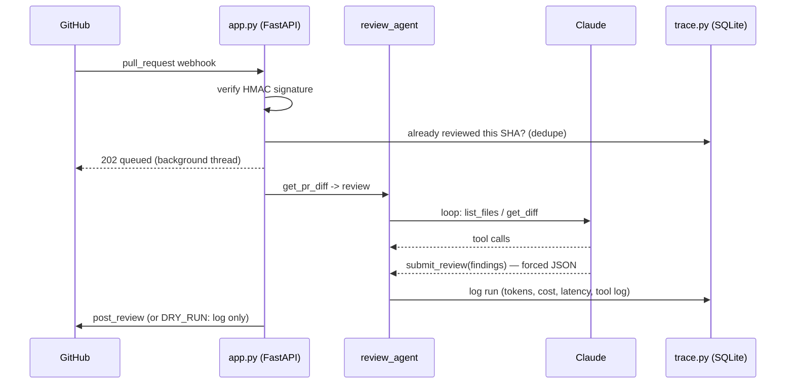

# Sentinel — an AI code-review agent that lives on real GitHub PRs

A production-style agentic service: GitHub `pull_request` webhooks come in,
an agent reviews the diff with real tools, and posts a review with inline
comments — with signature verification, idempotency, cost tracing, evals,
and a human-in-the-loop switch.

This is the portfolio version of "an agent is an LLM in a loop with tools."
The loop is 30 lines. **Everything else is the engineering that makes it
trustworthy** — and that's what agent-developer interviews actually test.

## Why this project (what it demonstrates)

| Production concern | Where it lives |
| ------------------ | -------------- |
| Webhook security (HMAC verify) | `github_client.verify_signature` |
| Forced structured output | `review_agent` — the `submit_review` tool IS the output schema |
| Context management | diff split into per-file hunks; agent fetches only what it needs |
| Observability | `trace.py` — every run logs tool calls, tokens, cost, latency |
| Idempotency | same head SHA never reviewed twice (`already_reviewed`) |
| Human-in-the-loop | `DRY_RUN=true` drafts reviews without posting |
| Evals | `evals/` — fixture diffs with known bugs + scoring harness |
| Tests | `tests/` — pytest, offline-runnable |
| Async processing | webhook ACKs instantly, review runs in background |

## Architecture



## What each file does

| File | Purpose |
| ---- | ------- |
| `core.py` | Agent loop + `RunStats` token/cost accumulator |
| `review_agent.py` | Diff splitting, review prompt, `submit_review` forced-output tool |
| `github_client.py` | Diff/file fetch, review posting, webhook HMAC verification |
| `trace.py` | SQLite trace store: runs, tool calls, cost, dedupe check |
| `app.py` | FastAPI: `/webhook`, `/review` (manual), `/traces`, `/health` |
| `evals/fixtures.py` | Diffs with planted bugs (SQL injection, hardcoded secret) + a clean one |
| `evals/run_evals.py` | Scoring harness — runs reviewer on fixtures, checks catches |
| `tests/test_core.py` | Offline unit tests (diff splitting, HMAC, cost math) |

## Setup — what to change after cloning

```bash
git clone https://github.com/AbdulhameedSk/AI-Code-Review-Agent
cd AI-Code-Review-Agent
pip install -r requirements.txt
```

Create `.env` (git-ignored):

```
ANTHROPIC_API_KEY=sk-ant-...       # console.anthropic.com
GITHUB_TOKEN=ghp_...               # github.com/settings/tokens (repo scope)
WEBHOOK_SECRET=any-random-string   # must match the repo webhook config
DRY_RUN=true                       # start true — drafts only, posts nothing
```

## How to run

**Tests (no keys needed):**

```bash
pytest tests/
```

**Manual review of any public PR:**

```bash
uvicorn app:app --port 8000
curl -X POST http://localhost:8000/review \
     -H "Content-Type: application/json" \
     -d "{\"owner\":\"OWNER\",\"repo\":\"REPO\",\"number\":123}"
```

**Evals (needs ANTHROPIC_API_KEY):**

```bash
python -m evals.run_evals
```

**Live webhooks:**

1. Run `uvicorn app:app --port 8000`, expose it (`ngrok http 8000`).
2. In your repo: Settings → Webhooks → add `https://<ngrok>/webhook`,
   content type `application/json`, secret = your `WEBHOOK_SECRET`,
   events: pull requests.
3. Open a PR — Sentinel reviews it (or logs a draft if `DRY_RUN=true`).

**See the traces:**

```bash
curl http://localhost:8000/traces
```

## How to deploy

Any host that runs Python. Start command:

```bash
uvicorn app:app --host 0.0.0.0 --port $PORT
```

Set the three env vars in the host's secrets panel. For always-on reviews,
deploy to Render/Railway/Fly and point the webhook at the public URL — no
ngrok needed.

## Extending

- **Inline comment line mapping**: findings carry approximate line numbers;
  mapping them to exact diff positions (GitHub's `position` field) is the
  natural next step.
- **More reviewers**: add a `security_agent` or `perf_agent` — same loop,
  different prompt, run in parallel, merge findings.
- **Better evals**: swap keyword scoring for LLM-as-judge.
